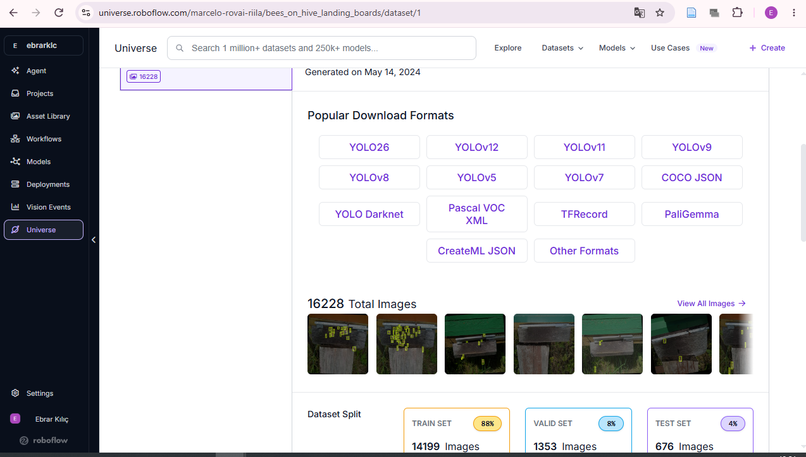
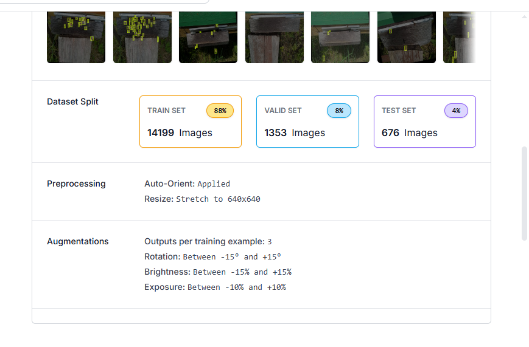
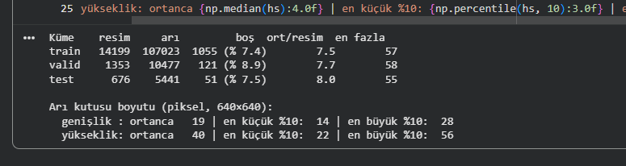
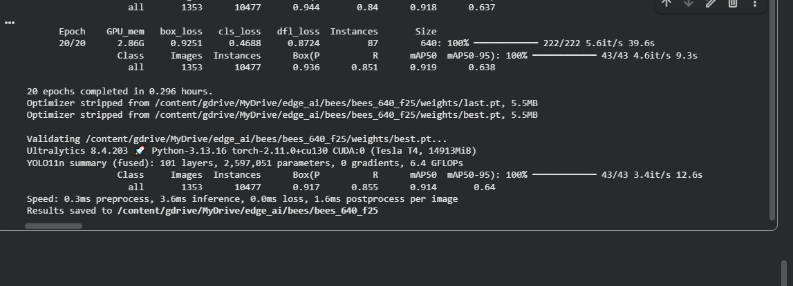
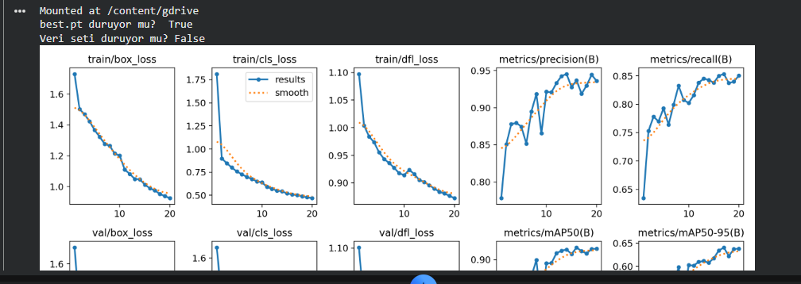
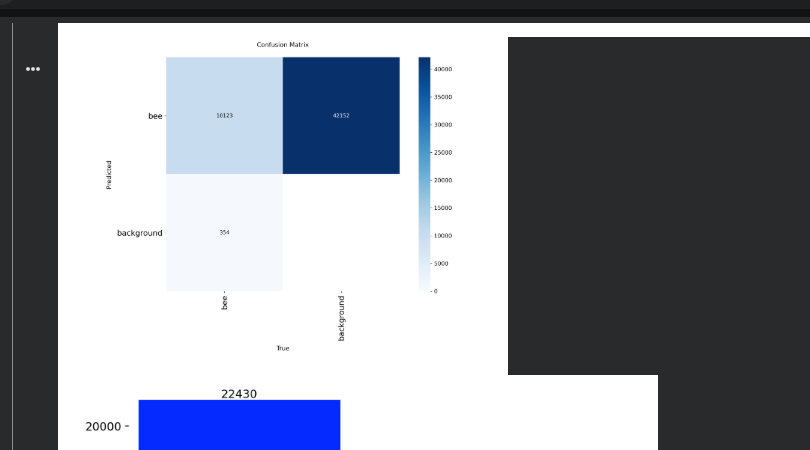
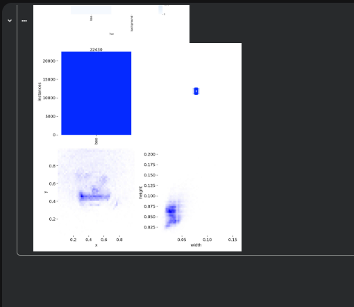
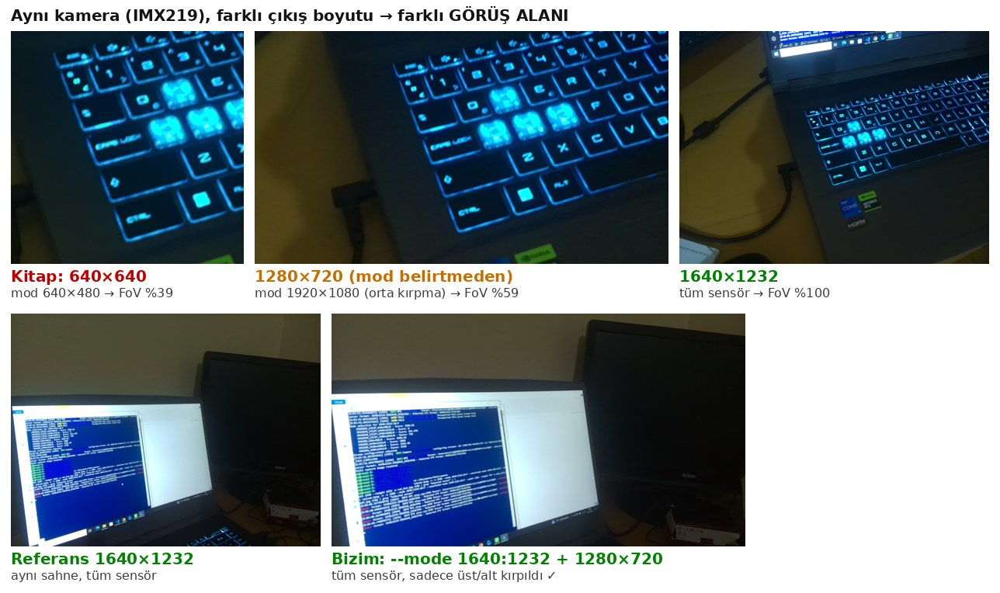
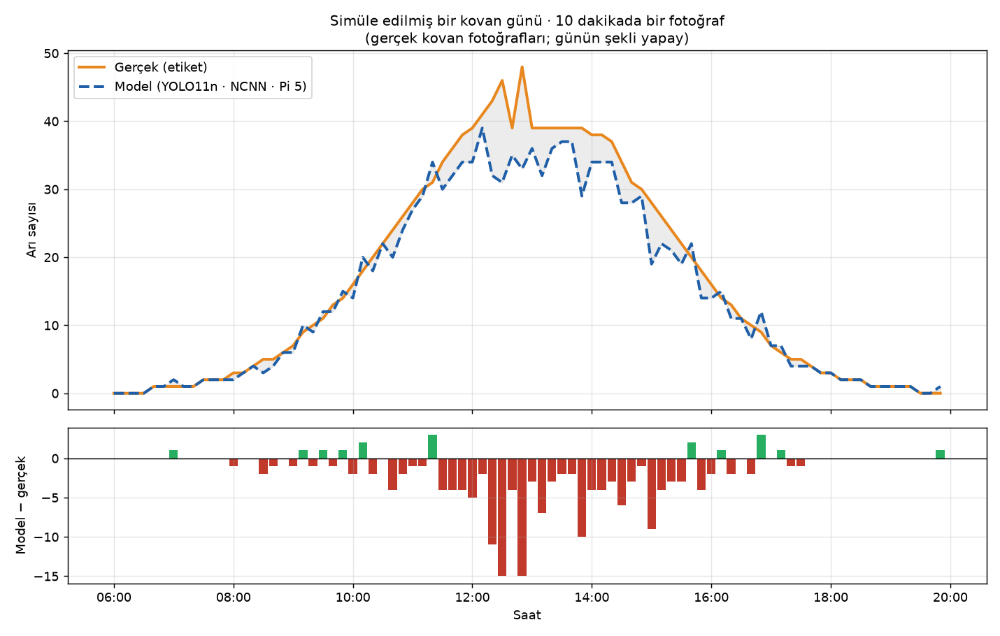
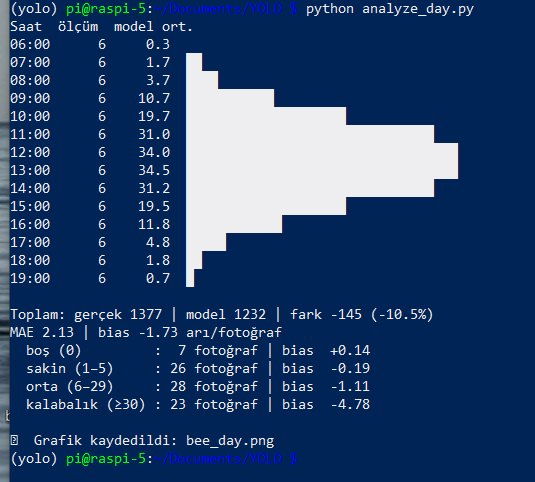

# 📘 Bölüm 7: YOLO ile Nesne Sayma, Kovan Girişinde Arılar

> **Kaynak:** Marcelo Rovai, *Edge AI Engineering: Hands-On with the Raspberry Pi*, s. 263–288
> **Donanım:** Raspberry Pi 5 (4 GB) · Kamera Modülü v2 (IMX219) · Raspberry Pi OS 64-bit · Python 3.13
> **Eğitim:** Google Colab, Tesla T4 · **Kütüphane:** Ultralytics 8.4
> **Hazırlayan:** Ebrar Kılıç. Bu notlar hem kendi öğrenmem hem de öğrencilerim için yazıldı.

Bu bölümün yeniliği **modelde değil, sistemde**: Bir YOLO modelini, kamerayla fotoğraf çeken, arıları sayan, sonucu veritabanına yazan ve **insansız, 7/24** çalışan bir ürüne dönüştürdük. Yol boyunca kitaptaki tasarımı **ölçerek** sorguladık ve beş yerde iyileştirdik.

YOLO'nun teorisi (ızgara, `(1, 5, 8400)` çıkışı, NMS) için: [Bölüm 6 reposundaki "YOLO: Sıfırdan Kahramana"](https://github.com/ebrarklc/raspberry-pi5-yolo-custom-detector/blob/main/yolo-sifirdan-kahramana.md).

---

## İçindekiler
1. [Sistemin büyük resmi](#1-sistemin-büyük-resmi)
2. [Veri setini sayılarla tanımak](#2-veri-setini-sayılarla-tanımak)
3. [Colab'da eğitim](#3-colabda-eğitim)
4. [Sayma için eşik seçimi: MAE ve bias](#4-sayma-için-eşik-seçimi-mae-ve-bias)
5. [Pi'de NCNN ve dilimlere ayrılmış değerlendirme](#5-pide-ncnn-ve-dilimlere-ayrılmış-değerlendirme)
6. [Sayma motoru: process_images.py + SQLite](#6-sayma-motoru-process_imagespy--sqlite)
7. [Kamera: görüş alanı tuzağı ve capture.sh](#7-kamera-görüş-alanı-tuzağı-ve-capturesh)
8. [Disk yönetimi](#8-disk-yönetimi)
9. [7/24: systemd, yeniden başlatma testi, log'lar, saat](#9-724-systemd-yeniden-başlatma-testi-loglar-saat)
10. [Simüle edilmiş bir arı günü](#10-simüle-edilmiş-bir-arı-günü)
11. [Kitaptan farklarımız](#11-kitaptan-farklarımız)
12. [Karşılaşılan hatalar ve çözümleri](#12-karşılaşılan-hatalar-ve-çözümleri)
13. [Mülakat soruları](#13-mülakat-soruları)
14. [Sözlük](#14-sözlük)

---

## 1. Sistemin büyük resmi

**Problem:** Arı popülasyonu çevre sağlığının göstergesidir. Kovan girişindeki arıları elle saymak imkânsızdır; girişte aynı anda **60'a kadar** arı olabilir.

```
         ☁️ Colab (bir kez)                         🍓 Raspberry Pi 5 (7/24, insansız)
┌──────────────────────────────┐      ┌────────────────────────────────────────────────────────────┐
│ Roboflow → YOLO11n eğitimi   │      │  📷 capture.sh ──.jpg──▶ 📂 capture/ ──▶ 🧠 process_images.py│
│ imgsz=640 · conf seçimi      │─────▶│  (systemd)              (bekleme odası)   (systemd)         │
│ best.pt                      │ scp  │                                              │              │
└──────────────────────────────┘      │                                              ▼              │
                                      │            📊 analyze_day.py ◀── 🗄️ bee_count.db (SQLite)   │
                                      └────────────────────────────────────────────────────────────┘
```

**Üretici–tüketici (producer–consumer) tasarımı:** Fotoğraf çeken (`capture.sh`) ile sayan (`process_images.py`) **ayrı** programlar. Biri yavaşlasa ya da çökse diğeri etkilenmez. Buna **gevşek bağlılık** (*loose coupling*) denir.

---

## 2. Veri setini sayılarla tanımak

**Veri seti:** Roboflow Universe → `marcelo-rovai-riila / bees_on_hive_landing_boards`, v1 (Sledevic 2023, CC BY 4.0).

<p align="center"></p>

### 2.1 6.762 mi, 16.228 mi?
| Küme | Ekranda | Hesap |
|---|---|---|
| Valid | 1.353 (%8) | 1.353 / 6.762 = **%20** |
| Test | 676 (%4) | 676 / 6.762 = **%10** |
| Train | 14.199 (%88) | (6.762 − 1.353 − 676) = 4.733 × **3** = 14.199 ✅ |

**Önce bölünmüş (%70/%20/%10), sonra SADECE train 3'e katlanmış.** Augmentation'ı bölmeden önce yapmak **veri sızıntısı** (*data leakage*) olurdu.

### 2.2 Ön işleme: Stretch
<p align="center"></p>

`Resize: Stretch to 640×640`: 1920×1080 resimler yatayda **÷3.0**, dikeyde **÷1.69** sıkıştırılmış. Model arıları **basık** haliyle öğrendi. → **Pi'de kamera görüntüsü de stretch edilmeli** (letterbox değil).

### 2.3 Etiket istatistikleri
<p align="center"></p>

| Küme | Resim | Arı | Boş resim | Arı/resim | En fazla |
|---|---|---|---|---|---|
| train | 14.199 | 107.023 | 1.055 (%7.4) | 7.5 | 57 |
| valid | 1.353 | 10.477 | 121 (%8.9) | 7.7 | 58 |
| test | 676 | 5.441 | 51 (%7.5) | 8.0 | 55 |

| Kutu boyutu (640×640) | Ortanca | En küçük %10 | En büyük %10 |
|---|---|---|---|
| Genişlik | **19 px** | 14 px | 28 px |
| Yükseklik | **40 px** | 22 px | 56 px |

- **Yükseklik ≈ 2.1 × genişlik:** Stretch'in tek başına açıkladığı oran 3.0 / 1.69 = **1.78**; kalan farkın arıların dikey duruşundan geldiği tahmin ediliyor (hipotez).
- **imgsz = 640 kararı (ölçerek):** En dar %10'luk arılar 14 px. P3 haritasında (stride 8) bir hücre 8 px → arı ~2 hücre kaplıyor. 320'de 7 px olurdu → **bir hücreden küçük**.

> **📝 Mülakat notu:** imgsz'yi **veriyi ölçerek** seç: En küçük nesneler, en ince ölçek haritasının (stride 8) en az 1–2 hücresini kaplamalı.

---

## 3. Colab'da eğitim

### 3.1 Üç akıllı ayar
| Ayar | Neden? |
|---|---|
| `fraction=0.25` | Kitapta tüm veriyle 25 epoch **2.7 saat**; bizde 20 epoch **~18 dakika** |
| `cache="ram"` | Colab'da sadece **2 CPU** var; veri hazırlama darboğaz. JPEG'ler bir kez açılıp RAM'de tutuldu (4.1 + 1.5 GB) |
| `project=` **Google Drive** | Oturum koptu (hücre numarası `[1]`'e döndü) ama `best.pt` Drive'da **kurtuldu** |
| API anahtarı **Colab Secrets**'ta | Kodda, çıktıda ve ekran görüntülerinde anahtar yok |

> **📝 Mülakat notu:** GPU'lu bir makinede eğitim yavaşsa önce **GPU kullanımına** bak. Düşükse darboğaz **veri yükleme hattıdır** (az CPU, yavaş disk, ağır augmentation).

### 3.2 ⚠️ `fraction` rastgele değil!
| | Boş resim oranı | Arı/resim |
|---|---|---|
| Tüm train | %7.4 | 7.5 |
| `fraction=0.25` (log: `3550 images, 81 backgrounds`) | **%2.3** | **6.3** (labels.jpg: 22.430 / 3.550) |

Ultralytics dosya listesinin **ilk** %25'ini alır. Dosya adları çekim tarihiyle başladığı için (`20230609a1026_...`) model belirli **günleri** gördü; boş ve kalabalık sahneler daha az temsil edildi. **Ders:** Alt küme **rastgele ve tabakalı** seçilmeli ve istatistikleri kontrol edilmeli.

### 3.3 Sonuçlar
<p align="center"></p>

| Metrik | Epoch 1 | **best.pt** | Kitap (tüm veri, v8n, 25 ep.) |
|---|---|---|---|
| Precision | 0.778 | **0.917** | — |
| Recall | 0.634 | **0.855** | — |
| mAP50 | 0.711 | **0.914** | 0.984 |
| mAP50-95 | 0.373 | **0.640** | — |

- **mAP50-95 neden düşük?** 19 px genişliğindeki bir kutuda 3–4 px kayma yüksek IoU eşiklerini kaçırır. Küçük nesnelerde normal.
- **Kitaptan düşük mAP50:** %25 veri, az background, 20 epoch. Hangisinin ne kadar etkilediği ayrı ayrı denenmeden (*ablation*) söylenemez.
- **T4'te 3.6 ms** çıkarım (box/wheel'de 320'de 4.1 ms): GPU küçük işlerde kapasitesinin çoğunu boşta tutuyor.

<p align="center"></p>

**Overfitting yok** (train ve val kayıpları birlikte düşüyor). Epoch 9'daki ani düşüş tek epoch'luk gürültü. mAP50 ~epoch 13'te düzleşti; mAP50-95 hâlâ hafifçe yükseliyor.

### 3.4 Confusion matrix (conf = 0.001)
<p align="center"></p>

10.123 doğru + 354 kaçırma = 10.477 ✅ · **42.152 "yanlış alarm"**: Val varsayılan eşiği (0.001) ile çizildiği için düşük güvenli çöp kutular. Bu matristen az background etkisi **okunamaz**; çalışma eşiğinde ölçmek gerekir (§4–5).

### 3.5 labels.jpg
<p align="center"></p>

Arılar y ≈ 0.45'te **yatay bir bantta** (kovan girişi). Genişlik–yükseklik dağılımı köşegenin üstünde: stretch'in görsel kanıtı.

---

## 4. Sayma için eşik seçimi: MAE ve bias

**Sayma sorusu mAP değil:** "Bu resimde kaç arı var?"

| Metrik | Anlamı |
|---|---|
| **MAE** | Resim başına ortalama \|tahmin − gerçek\| |
| **Bias** | Ortalama (tahmin − gerçek): **+** fazla, **−** eksik sayıyor |
| **Tam doğru** | Sayının tam tuttuğu resimlerin oranı |

676 test resmi, gerçek toplam 5.441 arı:

| conf | Toplam | Fark | MAE | Bias | Tam doğru |
|---|---|---|---|---|---|
| 0.1 | 6.447 | +%18.5 | 1.85 | +1.49 | %23.7 |
| 0.2 (kitap) | 5.711 | +%5.0 | 1.26 | +0.40 | %31.8 |
| **0.3** ⭐ | **5.345** | **−%1.8** | **1.22** | **−0.14** | %34.8 |
| 0.4 | 5.081 | −%6.6 | 1.28 | −0.53 | %35.5 |
| 0.5 | 4.837 | −%11.1 | 1.41 | −0.89 | %37.6 |
| 0.6 | 4.576 | −%15.9 | 1.63 | −1.28 | %37.9 |

- **Seçim: conf = 0.3** (MAE en düşük, bias ≈ 0). Eşik **modele özeldir**; kitabın 0.2'si kendi modeli için seçilmişti.
- **"Tam doğru" yanıltıcı:** Sakin resimlerde küçük hataları ödüllendiriyor, kalabalıktaki büyük hataları görmüyor. Tek başına bizi 0.6'ya götürürdü.
- **Teknik:** Model bir kez `conf=0.05` ile çalıştırıldı, eşikler sonradan uygulandı. NMS bir kutuyu yalnızca **daha yüksek skorlu** bir kutuyla çakışırsa sildiği için sonuç birebir aynıdır.
- ⚠️ **Dürüstlük:** Eşik **test** kümesinde seçildi. Doğrusu **valid**'de seçip test'te raporlamaktır.

**OOM dersi:** `model.predict(liste)` → liste **tek batch** olur → 676 resim aynı anda GPU'ya → `CUDA out of memory (4.13 GiB)`. Çözüm: **klasör** ver (resimler tek tek işlenir). `stream=True` batch boyutunu değiştirmez.

---

## 5. Pi'de NCNN ve dilimlere ayrılmış değerlendirme

### 5.1 Export
```bash
yolo export model=models/bees_640_yolo11n.pt format=ncnn imgsz=640
```
| | Arı (640) | Box/wheel (320, Bölüm 6) |
|---|---|---|
| Çıkış | **(1, 5, 8400)** = 4 + 1 sınıf; 80² + 40² + 20² | (1, 6, 2100) |
| GFLOPs | 6.4 | 1.6 |
| memory OPS | 98.9 M | 26.4 M |
| `.bin` | 10.1 MB | 10.0 MB |

**Hesap 4 kat, dosya aynı boyut. Neden?** **Ağırlık paylaşımı:** Bir konvolüsyon filtresi resmin her konumunda **aynı** ağırlıklarla çalışır. Dosya boyutu parametre sayısına, hesap ise konum sayısına bağlıdır. `imgsz=640` zaten varsayılan, ama **açıkça yazıldı** (*explicit is better than implicit*).

### 5.2 `count_test_bees.py`: Pi'de 676 resim
| | iou = 0.7 ⭐ | iou = 0.3 (kitap) |
|---|---|---|
| Toplam | 5.344 (−%1.8) · **Colab ile 1 arı fark** ✅ | 5.115 (−%6.0) |
| MAE / bias | **1.21 / −0.14** | 1.29 / −0.48 |
| Kalabalık (≥30, 31 resim) | −5.45 | **−7.58** |
| Sakin (1–5, 329 resim) | +0.52 | +0.44 |
| Boş (0, 51 resim) | **1.02 hayalet arı/resim** | 1.02 |
| Çıkarım | ~70–77 ms | — |

- **iou = 0.3, kalabalıkta gerçek komşu arıları "kopya" sanıp siliyor** → **iou = 0.7** seçildi.
- **Ortalama, yapıyı gizler:** Toplam bias −0.14 ama sakinde **+**, kalabalıkta **−**. İki hata **tesadüfen** birbirini götürüyor → **dinamik aralık sıkışması**.
- `fraction` hipotezleri sonuçlarla **uyumlu**: Boşta hayalet arı (az background), kalabalıkta eksik (az kalabalık sahne). Görevin doğal zorluğundan ayırmak için tüm veriyle yeniden eğitim gerekir.
- **Hız 320 → 640: ×5.2** (hesap ×4): Ara haritaların önbelleğe sığmaması hipotezini destekliyor. 10 s'lik çekim aralığında 77 ms **fazlasıyla yeterli** (Pi Zero'da kitapta ~730 ms).

> **📝 Mülakat notu:** Kalabalık sahnelerde NMS IoU eşiği **yüksek** tutulur. Düşük eşik birbirine değen gerçek nesneleri siler. Çözüm yelpazesi: Soft-NMS, NMS'siz modeller (YOLOv10/YOLO26), yoğunluk haritası yöntemleri.

---

## 6. Sayma motoru: `process_images.py` + SQLite

### 6.1 Kitaptan iyileştirmeler
| Kitap | Sorun | Bizim |
|---|---|---|
| İşlenenler **bellekte** (`set`) | Yeniden başlatınca hepsi baştan sayılır, kopya satırlar | İşlenen resim **taşınır/silinir** → durum **diskte** (*idempotent*) |
| Kamera resmi doğrudan modele | Letterbox → arılar eğitimdeki gibi basık değil | `cv2.resize(frame, (640, 640))` → **stretch** |
| `timestamp, count` | Teşhis bilgisi az | `file, captured_at, processed_at, count, inference_ms` |
| `conf=0.2, iou=0.3` | Bizim model için ölçülmüş değil | `conf=0.3, iou=0.7` |
| Resimler birikir | Disk ~2 haftada dolar | Her 30 resimden 1'i saklanır (§8) |

### 6.2 SQLite şeması
```sql
CREATE TABLE IF NOT EXISTS bee_counts (
    id INTEGER PRIMARY KEY AUTOINCREMENT, file TEXT,
    captured_at TEXT, processed_at TEXT, count INTEGER, inference_ms REAL)
```
- **Parametreli sorgu** (`VALUES (?, ?, ...)`): SQL injection'a karşı güvenli.
- **Sıra önemli:** Önce `commit`, sonra resmi sil. Tersinde, arada çökme olursa sayı kaybolur.

### 6.3 Testler
- **Kamera taklidi:** Test resimleri `cp x.part` + `mv x.jpg` ile 3 s arayla bırakıldı (**atomik yazma**: izleyici yarım dosya görmez).
- **Backlog + idempotency:** Program durduruldu, 3 resim birikti. Yeniden başlayınca **aynı saniyede** işlendi; önceki 7 resim tekrar sayılmadı (10 kayıt, kopya yok).

| id | Çekim | İşlenme | Durum |
|---|---|---|---|
| 1–7 | 10:55:07… | +1–2 s | Program çalışıyordu |
| 8–10 | 10:55:28–34 | **10:57:13** (hepsi) | Program kapalıydı → backlog |

> **📝 Mülakat notu:** **Event time** (olayın gerçekleştiği an: `captured_at`) ile **processing time** (`processed_at`). Analiz event time ile yapılır; ikisinin farkı sistemin **sağlık göstergesidir**.

---

## 7. Kamera: görüş alanı tuzağı ve `capture.sh`

### 7.1 Deney: Aynı kamera, farklı boyut → farklı görüş alanı
<p align="center"></p>

`libcamera`, istenen boyuta en yakın **sensör modunu** puanlayarak seçiyor (log'da `Score`, `Selected sensor format`):

| İstek | Seçilen sensör modu | Görüş alanı |
|---|---|---|
| `--width 640 --height 640` (**kitap**) | 640×480 → `(1000,752)/1280x960` **orta kırpma** | **%39** + büyütme (bulanık) |
| `--width 1280 --height 720` | 1920×1080 → `(680,692)/1920x1080` **orta kırpma** | %59 |
| `--width 1640 --height 1232` | 1640×1232 → tüm sensör | %100 |
| **`--mode 1640:1232:10:P` + 1280×720** ⭐ | 1640×1232 → tüm sensör, üst/alt kırpılır | **%100 genişlik, 16:9** |

- `rpicam` en-boy oranını korur: **kırpar, asla stretch etmez**.
- **Training/serving uyumu:** Eğitim verisi 16:9 → stretch → 640². Bizim zincir: kamera **16:9** → `process_images.py` stretch → 640². **Birebir aynı yol.**

> **📝 Mülakat notu:** Çözünürlük ≠ görüş alanı. Düşük çözünürlük isteyince kamera sensörün bir **parçasını** kullanabilir (*sensor crop mode*). Kamera ayarları modelin bir parçasıdır; log'dan ve deneyle doğrula, dokümante et.

### 7.2 `capture.sh` (kitaba göre)
| Kitap | Bizim |
|---|---|
| 640×640 (dar FoV) | `--mode 1640:1232:10:P --viewfinder-mode ...` + 1280×720 |
| Doğrudan `$DATE.jpg` | `.part` → `mv` (atomik) |
| Hata kontrolü yok | `if rpicam-jpeg ...; then ... else ... fi` |
| `-t` yok (5 s önizleme) | `-t 1500` (pozlama için yeterli) |

**Kayma (drift):** `sleep 10` + ~2 s çekim = ~**12 s** (ölçüm: 11, 12, 12, 12 s). Zaman damgası dosya adında olduğu için analiz etkilenmiyor.

**Uçtan uca gecikme:** Çekim başı → kayıt ≈ 1–3 s (pozlama 1.5 s + izleyici ≤1 s + çıkarım 0.07 s). Model zincirin **en hızlı** halkası.

---

## 8. Disk yönetimi
```
1280×720 JPEG ≈ 170 KB × ~7.200 fotoğraf/gün ≈ 1.2 GB/gün  → 18 GB boş alan ~15 günde dolar ❌
Her 30'dan 1'i (~6 dakikada bir) sakla      ≈ 40 MB/gün   → ~450 gün ✅
SQLite: ~100 bayt/satır × 7.200 ≈ 0.7 MB/gün (ihmal edilebilir)
```
Saklanan örnekler **denetim** (model ne gördü?), **data drift** takibi ve ileride **yeniden eğitim** için değerli.

---

## 9. 7/24: systemd, yeniden başlatma testi, log'lar, saat

### 9.1 Neden systemd?
| | Terminal kapanınca | Pi açılınca | Çökünce | Log |
|---|---|---|---|---|
| `nohup` / `screen` (kitap) | ✅ yaşar | ❌ | ❌ | dağınık |
| **systemd** | ✅ | ✅ `enable` | ✅ `Restart=on-failure` | ✅ `journalctl` |

Unit dosyaları: [`systemd/`](systemd/). Kritik satırlar: `User=pi` (en az yetki) · `ExecStart=/home/pi/yolo/bin/python` (venv'i etkinleştirmeye gerek yok) · `Environment=PYTHONUNBUFFERED=1` (log'lar gecikmesin) · `KillSignal=SIGINT` (`finally` bloğu çalışsın, DB düzgün kapansın) · `RestartSec=10`.

```bash
sudo cp systemd/*.service /etc/systemd/system/
sudo systemctl daemon-reload
sudo systemctl enable --now bee-capture.service bee-counter.service
journalctl -u bee-counter.service -f
```

### 9.2 Yeniden başlatma testinin yakaladığı hata
İlk `sudo reboot` sonrası: `bee-capture` → **active**, `bee-counter` → **inactive**. Kamera çekti, 11 fotoğraf birikti.

**Sebep (güçlü hipotez):** Kamera unit'inde `After=multi-user.target` + `WantedBy=multi-user.target` → **sıralama döngüsü** (target, istediği servisi otomatik bekler; servis de target'ı bekliyordu). systemd döngüyü bir işi iptal ederek kırar. Satır silinince sorun kayboldu, sonraki açılışta `ordering cycle` uyarısı yok. Hatalı açılışın log'u **volatile journal** yüzünden silindiği için doğrudan gösterilemedi.

`systemctl start bee-counter` → 11 fotoğraflık **backlog** hemen işlendi; hiçbir fotoğraf kaybolmadı.

> **📝 Mülakat notu:** systemd'de `After=` **sıralama**, `Wants=` **bağımlılıktır**. Bir servisi kendisini isteyen target'tan sonraya sıralamak döngü yaratır. Ve **sahaya çıkmadan önce mutlaka yeniden başlatma testi** yap.

### 9.3 Kalıcı log'lar
```
# /usr/lib/systemd/journald.conf.d/40-rpi-volatile-storage.conf
Storage=volatile          ← Raspberry Pi OS varsayılanı (SD kart ömrü için)
```
```bash
sudo mkdir -p /etc/systemd/journald.conf.d
printf '[Journal]\nStorage=persistent\nSystemMaxUse=200M\n' | sudo tee /etc/systemd/journald.conf.d/50-persistent.conf
sudo systemctl restart systemd-journald
sudo journalctl --flush        # RAM'deki log'ları diske taşı
```
**Takas:** SD aşınması ↔ insansız cihazda hata ayıklayabilmek. `SystemMaxUse` ile sınırlandı.

### 9.4 Saat
Açılıştan hemen sonra `System clock synchronized: no` → birkaç dakika sonra `yes` (NTP). RTC pili yoksa, internetsiz bir sahada elektrik kesintisinden sonra **bütün zaman damgaları kayar**. Saha için: **RTC pili** ya da GPS.

---

## 10. Simüle edilmiş bir arı günü

Elimizde arı yok. Test kümesindeki **gerçek kovan fotoğrafları** 06:00–20:00 arasına, 10 dakikada bir, öğlen zirve yapan bir **çan eğrisiyle** dağıtıldı (`simulate_day.py`). Sistem **hiç değişmeden** saydı.

> ⚠️ **Gerçek:** fotoğraflardaki arılar, etiketler, modelin sayımı ve sistemin tamamı. **Yapay:** günün şekli ve zamanlar. 13:00–13:50'deki düz 39'lar seçim yönteminin yapaylığıdır (test kümesinde 40–45 arılık az resim var).

<p align="center"></p>
<p align="center"></p>

| | Değer |
|---|---|
| 84 fotoğraf (14 saat) işleme süresi | **~7 s** (~12 fotoğraf/s) |
| Gerçek / model toplam | 1.377 / 1.232 → **−%10.5** |
| MAE / bias | 2.13 / −1.73 |
| Boş (7) · Sakin (26) · Orta (28) · Kalabalık (23) bias | +0.14 · −0.19 · −1.11 · **−4.78** |

**Bulgular:**
1. **Tepe basıklaşması:** Gerçek zirve 48, model ~35–39'da kalıyor. Hata kalabalıkla **doğrusal değil, daha hızlı** büyüyor (46–48 arıda **−15**). Buna **ölçeğe bağlı yanlılık** denir.
2. **Aynı model, farklı toplam hata:** Test kümesinde −%1.8, bu günde −%10.5. Fark **sahne dağılımından**: Simüle günde kalabalık oranı yüksek. Model hatası sabit bir sayı değil, verinin dağılımına bağlı (**distribution shift**).
3. Kalabalık dilimde −4.78 ≈ test kümesindeki −5.45 → bulgu **tekrarlanabilir**. Küçük dilimlerde (7 boş resim) belirsizlik büyük.
4. **SQL `GROUP BY`** ile saatlik özet: Arıcının sorusu ("hangi saatler hareketli?") tek sorguyla cevaplanıyor.

---

## 11. Kitaptan farklarımız
| # | Kitap | Biz | Kanıt |
|---|---|---|---|
| 1 | `conf=0.2` | `conf=0.3` | Bias +0.40 → −0.14 (§4) |
| 2 | `iou=0.3` | `iou=0.7` | Kalabalık −7.58 → −5.45 (§5) |
| 3 | Kamera 640×640 | `--mode 1640:1232` + 1280×720 + stretch | FoV %39 → %100 (§7) |
| 4 | Bellekte `set`, resimler birikir | Diskte durum + örnek saklama | İdempotency testi, disk hesabı (§6, §8) |
| 5 | `nohup` / `screen` | systemd + kalıcı log | Yeniden başlatma testi (§9) |
| 6 | YOLOv8n, tüm veri | YOLO11n, `fraction=0.25` | 2.7 sa → 18 dk; bedeli mAP50 0.984 → 0.914 |

---

## 12. Karşılaşılan hatalar ve çözümleri
| Belirti | Sebep | Çözüm |
|---|---|---|
| `NameError: SAVE` | Colab çalışma zamanı sıfırlandı | Drive'a kayıt + tam yollar |
| `CUDA out of memory (4.13 GiB)` | `predict(liste)` = tek batch | Klasör ver; `gc.collect()` + `empty_cache()` |
| `Could not resolve hostname raspi-5.local` | Okul ağı mDNS iletmiyor | IP kullan (`hostname -I`, `arp -a`, MAC `2c-cf-67`) |
| `failed to open file test_images/.jpg` | Betik satırı terminalde; `$DATE` boş, klasör yok | Betikleri bağlamıyla çalıştır |
| Kitabın 640×640 fotoğrafı dar ve bulanık | Sensör kırpma modu | `--mode 1640:1232:10:P` |
| `bee-capsudo systemctl ...` / `restart: command not found` | `sudo`'lu çok satırlı yapıştırma | `sudo` komutlarını **tek tek** yapıştır |
| Reboot sonrası `bee-counter` inactive | Sıralama döngüsü | `After=multi-user.target` satırını sil |
| `-b -1`: no persistent journal | `40-rpi-volatile-storage.conf` | `50-persistent.conf` + `journalctl --flush` |

---

## 13. Mülakat soruları
1. **Augmentation bölmeden önce mi sonra mı?** → Sonra ve sadece train'e; yoksa veri sızıntısı.
2. **imgsz'yi nasıl seçersin?** → Etiketlerden nesne boyutunu ölç; en küçükler stride 8 haritasında ≥1–2 hücre.
3. **Sayma modelini hangi metrikle değerlendirirsin?** → MAE + bias + dilimlere ayrılmış bias; "tam doğru" ve toplam bias tek başına yanıltıcı.
4. **Kalabalık sahnede NMS IoU eşiği?** → Yüksek; düşük eşik komşu gerçek nesneleri siler.
5. **Toplam bias ≈ 0 ise model iyi mi?** → Değil; zıt yönlü hatalar birbirini götürebilir (ortalama yapıyı gizler).
6. **Test'te %2, sahada %10 hata. Neden?** → Dağılım kayması (sahne/yoğunluk dağılımı farklı).
7. **Model boyutu aynı, süre 5 kat. Nasıl?** → Ağırlık paylaşımı: boyut parametreye, süre FLOPs + bellek erişimine bağlı.
8. **İki programın aynı dosyaya eriştiği yarış durumu nasıl önlenir?** → Geçici adla yaz, bitince atomik `rename`.
9. **Idempotency nedir, burada nasıl sağlandı?** → Tekrar çalıştırmak sonucu değiştirmez; durum bellekte değil diskte (işlenen dosya taşınır/silinir).
10. **Event time ve processing time?** → Olayın anı ve işlendiği an; analiz event time ile, fark sağlık göstergesi.
11. **Edge cihazda 7/24 servis?** → systemd: enable, Restart=, journal, User=; nohup üretim çözümü değil.
12. **`After=` ile `Wants=` farkı?** → Sıralama ve bağımlılık; yanlış kullanım döngü yaratır.
13. **İnsansız cihazda log ve saat?** → Kalıcı journal (boyut sınırlı), RTC/NTP/GPS.
14. **Kamera değişti, model kötüleşti?** → FoV, çözünürlük, en-boy oranı ve ön işleme eğitimle uyumlu mu?
15. **Ham veriyi saklamalı mı?** → Örnekleme: denetim, drift takibi, yeniden eğitim; disk bütçesiyle dengele.

---

## 14. Sözlük
| Terim | Açıklama |
|---|---|
| **Ablation** | Etkenleri tek tek değiştirip etkilerini ayrı ayrı ölçmek |
| **Atomik yazma** | Dosyayı geçici adla yazıp bitince tek hamlede yeniden adlandırmak |
| **Backlog** | Sistem kapalıyken biriken, açılınca eritilen iş |
| **Bias (sayma)** | Ortalama işaretli hata; sistematik fazla/eksik sayma |
| **Dilimlere ayrılmış değerlendirme** | Metrikleri alt gruplarda (boş/sakin/kalabalık) ayrı hesaplamak |
| **Distribution shift** | Kullanım verisinin dağılımının değerlendirme verisinden farklı olması |
| **Drift (zaman)** | Döngü süresinin hedef aralıktan sapması |
| **Event / processing time** | Olayın gerçekleştiği an / sistemin işlediği an |
| **FoV** | Görüş alanı |
| **Idempotency** | Bir işlemi tekrar etmenin sonucu değiştirmemesi |
| **journald / journalctl** | systemd'nin log sistemi / log okuma aracı |
| **MAE** | Ortalama mutlak hata |
| **NTP / RTC** | İnternetten saat senkronu / pil destekli donanım saati |
| **Observability** | Sistemin içini dışarıdan anlayabilme (log, metrik, iz) |
| **Ordering cycle** | systemd'de birbirini bekleyen birimler döngüsü |
| **Producer–consumer** | Üreten ve tüketen işlerin bağımsız çalıştığı tasarım |
| **Race condition** | İki işlemin aynı kaynağa aynı anda erişmesinden doğan hata |
| **Scale-dependent bias** | Hatanın nesne yoğunluğuyla birlikte büyümesi |
| **Sensor crop mode** | Sensörün yalnızca bir parçasını kullanan kamera modu |
| **SQLite** | Tek dosyalık, sunucusuz veritabanı |
| **systemd unit** | Bir servisin nasıl çalışacağını anlatan ayar dosyası |
| **Volatile journal** | RAM'de tutulan, yeniden başlatmada silinen log'lar |
| **Weight sharing** | Aynı filtrenin resmin her konumunda kullanılması |
