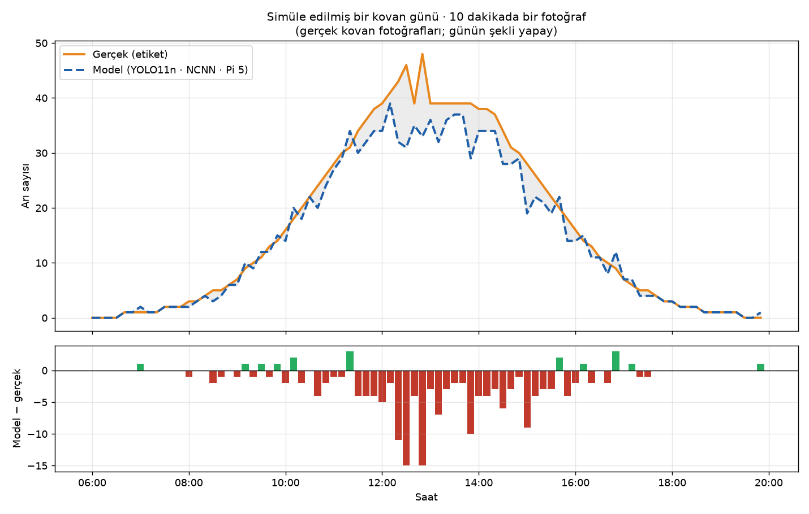
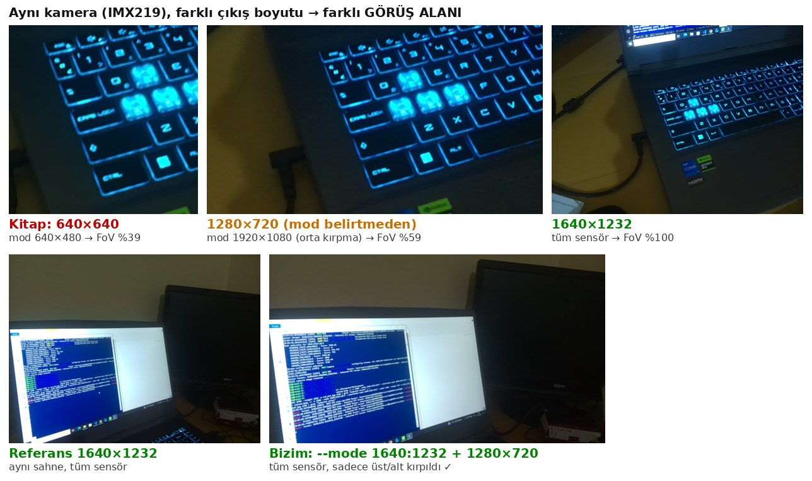

# 🐝 Raspberry Pi 5: YOLO11n ile 7/24 Arı Sayma Sistemi

**Kovan girişindeki arıları sayan, insansız çalışan bir edge AI sistemi. YOLO11n'i Colab'da eğittim, Raspberry Pi 5'te NCNN ile çalıştırdım. Kamera, sayma motoru ve SQLite veritabanı systemd servisleri olarak yeniden başlatmaya dayanıklı şekilde çalışıyor. Kitaptaki tasarımı ölçerek sorguladım ve beş yerde iyileştirdim.**
Edge AI serisinin 7. bölümü.

-C51A4A?logo=raspberrypi&logoColor=white)


<p align="center">
  <br>
  <i>Simüle edilmiş bir kovan günü: gerçek kovan fotoğrafları 10 dakikada bir sisteme verildi (günün şekli yapay). Sakin saatlerde model ≈ gerçek; kalabalıkta sistematik eksik sayma ("tepe basıklaşması").</i>
</p>

---

## 🎯 Sistem

```
📷 capture.sh  ──.part→.jpg──▶  📂 capture/  ──▶  🧠 process_images.py  ──▶  🗄️ bee_count.db  ──▶  📊 analyze_day.py
 (systemd)     her ~12 s, tam FoV, 16:9          (systemd) stretch→640²,         (çekim + işlenme             (saatlik özet,
                                                 YOLO11n NCNN, conf .3/iou .7    zamanı, sayı, ms)             grafik)
```
- **Üretici–tüketici:** Çekim ve sayma bağımsız; biri durursa diğeri devam eder, biriken iş (**backlog**) sonra eritilir.
- **İdempotent:** İşlenen resim taşınır/silinir; yeniden başlatma aynı resmi iki kez saymaz.
- **Disk bütçesi:** Her 30 resimden 1'i örnek olarak saklanır (1.2 GB/gün → 40 MB/gün).
- **7/24:** systemd (`enable`, `Restart=on-failure`), kalıcı journal; **yeniden başlatma testiyle** doğrulandı.

---

## 📊 Sonuçlar

### Eğitim (Colab T4 · 20 epoch · imgsz 640 · `fraction=0.25`)
| P | R | mAP50 | mAP50-95 | Süre |
|---|---|---|---|---|
| 0.917 | 0.855 | **0.914** | 0.640 | ~18 dk (kitap: tüm veriyle 2.7 saat, mAP50 0.984) |

### Sayma eşiği: Ölçerek seçildi (676 test resmi, gerçek 5.441 arı)
| conf | Toplam | MAE | Bias |
|---|---|---|---|
| 0.2 (kitap) | +%5.0 | 1.26 | +0.40 |
| **0.3** ⭐ | **−%1.8** | **1.22** | **−0.14** |
| 0.5 | −%11.1 | 1.41 | −0.89 |

### Pi 5'te (NCNN, `(1, 5, 8400)`)
| | iou 0.7 ⭐ | iou 0.3 (kitap) |
|---|---|---|
| MAE / bias | 1.21 / −0.14 (Colab ile 1 arı fark) | 1.29 / −0.48 |
| Kalabalık (≥30 arı) bias | −5.45 | −7.58 |
| Boş tahtada hayalet arı | 1.02 / resim | 1.02 |
| Çıkarım | ~70–77 ms | |

➡️ **Ortalama, yapıyı gizler:** Toplam bias ≈ 0 ama model **sakinde fazla, kalabalıkta eksik** sayıyor. Simüle günde kalabalık oranı yüksek olduğu için toplam hata **−%10.5**'e çıktı (**distribution shift**).

### 📷 Kamera tuzağı: Kitabın 640×640 ayarı görüş alanı genişliğinin %61'ini kesiyor
<p align="center"></p>

`libcamera` küçük çıktılar için sensörün **orta kısmını kırpan** modları seçiyor. Çözüm: `--mode 1640:1232:10:P` + 1280×720 (16:9, eğitim verisiyle aynı oran) + `process_images.py`'de **stretch** → Roboflow ön işlemesinin birebir aynısı.

---

## 🧠 Kitaptan farklarımız

| # | Kitap | Biz | Neden? |
|---|---|---|---|
| 1 | `conf=0.2` | **0.3** | MAE/bias ölçümü |
| 2 | `iou=0.3` | **0.7** | Düşük IoU kalabalıkta gerçek arıları siliyor |
| 3 | `rpicam-jpeg 640×640` | **tam sensör + 16:9 + stretch** | FoV %39 → %100, training/serving uyumu |
| 4 | Bellekte liste, resimler birikir | **disk durumu + örnek saklama** | İdempotency, disk ~2 hafta → >1 yıl |
| 5 | `nohup` / `screen` | **systemd + kalıcı journal** | Açılışta başlama, çökünce yeniden başlama, teşhis |

---

## 📁 Repo yapısı

```
├── 07-yolo-bee-counting.md          # 📘 Detaylı ders notu: her karar, her ölçüm, her hata
├── notebooks/
│   └── yolo11_bees_counting_colab.ipynb   # Colab: veri analizi, eğitim, eşik seçimi (anahtar Secrets'tan)
├── models/
│   ├── bees_640_yolo11n.pt               # Eğitilmiş model (fp16, 5.5 MB)
│   └── bees_640_yolo11n_ncnn_model/      # NCNN (imgsz 640, names {0: bee})
├── capture.sh            # 📷 Kamera: tam FoV, 16:9, atomik yazma
├── process_images.py     # 🧠 Sayma motoru: izle → stretch → say → SQLite → sakla/sil
├── read_db.py            # 🗄️ Veritabanını tablo + özet olarak oku
├── count_test_bees.py    # 🧪 Test kümesinde MAE/bias, iou 0.7 vs 0.3, dilimler
├── simulate_day.py       # 🌅 Gerçek fotoğraflardan simüle gün
├── analyze_day.py        # 📈 Saatlik özet (GROUP BY) + bee_day.png
├── sim_truth.csv         # Simüle günün cevap anahtarı
├── systemd/              # bee-capture.service, bee-counter.service
└── assets/               # Görseller
```

---

## ⚡ Hızlı başlangıç (Raspberry Pi 5)

```bash
# Ortam (Bölüm 6): torch'u ultralytics'ten ÖNCE ve CPU index'ten kur
python -m venv ~/yolo --system-site-packages && source ~/yolo/bin/activate
pip install torch torchvision --index-url https://download.pytorch.org/whl/cpu
pip install ultralytics

git clone https://github.com/ebrarklc/raspberry-pi5-yolo-bee-counter.git ~/Documents/YOLO
cd ~/Documents/YOLO && chmod +x capture.sh

# Elle çalıştır (iki terminal)
python process_images.py        # terminal 1
./capture.sh                    # terminal 2

# 7/24 servis olarak
sudo cp systemd/*.service /etc/systemd/system/
sudo systemctl daemon-reload
sudo systemctl enable --now bee-capture.service bee-counter.service
journalctl -u bee-counter.service -f
python read_db.py
```
> Servis dosyaları `/home/pi/Documents/YOLO` ve `/home/pi/yolo` yollarını varsayar; farklıysa düzenle.

**Simüle gün:** Notebook'un son hücresinin ürettiği `bees_test.zip`'i `images/bees_test/` altına aç → `python simulate_day.py && python process_images.py` (bitince Ctrl+C) → `python analyze_day.py`.

---

## 🧠 Öğrenilen dersler

| Durum | Ders |
|---|---|
| Ekranda %88/%8/%4, hesapta %70/%20/%10 | Augmentation sadece train'e uygulanmış; ekrandaki oranlara sağlama yap |
| Arılar 19×40 px | imgsz'yi **ölçerek** seç (640) |
| `fraction=0.25` → boş resim %7.4 → %2.3 | `fraction` alfabetik ilk %25'i alır; alt küme rastgele ve tabakalı olmalı |
| Colab sıfırlandı, model Drive'da kurtuldu | Uzun işlerin çıktısı kalıcı depoya |
| `predict(liste)` → CUDA OOM | Liste = tek batch; klasör ver |
| "Tam doğru" metriği 0.6'yı seçerdi | Metriği işin sorusuna göre seç: sayma için MAE + bias |
| Toplam bias −0.14, kalabalıkta −5.45 | Ortalama yapıyı gizler: dilimlere ayırarak değerlendir |
| Test −%1.8, simüle gün −%10.5 | Model hatası verinin dağılımına bağlı |
| Kitabın kamera ayarı FoV'un %61'ini kesiyor | Kamera ayarları modelin parçası; log'dan doğrula |
| Reboot sonrası sayıcı başlamadı | systemd sıralama döngüsü; sahaya çıkmadan reboot testi |
| Önceki açılışın log'u yok | Raspberry Pi OS varsayılanı volatile journal; kalıcı yap |
| `synchronized: no` | İnternetsiz sahada RTC pili/GPS gerekir |

---

## 🚀 Geliştirme fikirleri
- [ ] Tüm veriyle (ya da **rastgele** %25'le) yeniden eğitim; dilim tablosunu karşılaştır
- [ ] Eşiği **valid**'de seç, test'te raporla
- [ ] Kalabalık için **kalibrasyon** (valid'de `a × sayı + b`)
- [ ] YOLO26n (NMS'siz) ile kalabalık sahne karşılaştırması
- [ ] Saklanan örneklerle hata analizi (hayalet arılar nerede?)
- [ ] DHT22 ile sıcaklık/nem + Flask grafik paneli
- [ ] Takip (ByteTrack) ile giriş/çıkış yönü sayımı
- [ ] RTC pili + saha testi

---

## 🗺️ Edge AI serisi

| # | Bölüm | Repo |
|---|---|---|
| 1 | Raspberry Pi 5 kurulumu | [raspberry-pi5-edge-ai-setup](https://github.com/ebrarklc/raspberry-pi5-edge-ai-setup) |
| 2 | Görüntü sınıflandırma temelleri | [raspberry-pi5-image-classification-litert](https://github.com/ebrarklc/raspberry-pi5-image-classification-litert) |
| 3 | 🏆 Kendi görüntü sınıflandırıcım | [raspberry-pi5-custom-image-classifier](https://github.com/ebrarklc/raspberry-pi5-custom-image-classifier) |
| 4 | 🏆 Nesne tespiti | [raspberry-pi5-object-detection](https://github.com/ebrarklc/raspberry-pi5-object-detection) |
| 5 | Özel nesne tespiti (Edge Impulse) | *yakında* |
| 6 | 🚀 YOLO: eğit ve deploy et | [raspberry-pi5-yolo-custom-detector](https://github.com/ebrarklc/raspberry-pi5-yolo-custom-detector) |
| 7 | 🐝 YOLO ile 7/24 arı sayma | 📍 *bu repo* |

---

## 📚 Kaynaklar
- Marcelo Rovai, *Edge AI Engineering: Hands-On with the Raspberry Pi* (UNIFEI, 2026), s. 263–288
- Sledevic, T. (2023). *Labeled dataset for bee detection and direction estimation on beehive landing boards.* Mendeley Data, V5. doi:10.17632/8gb9r2yhfc.5
- [Roboflow Universe: Bees_on_Hive_landing_boards](https://universe.roboflow.com/marcelo-rovai-riila/bees_on_hive_landing_boards) (CC BY 4.0)
- [Ultralytics YOLO](https://docs.ultralytics.com) · [NCNN](https://github.com/Tencent/ncnn) · [rpicam-apps](https://www.raspberrypi.com/documentation/computers/camera_software.html)

> ⚖️ Ultralytics modelleri **AGPL-3.0** lisanslıdır. Veri seti **CC BY 4.0**.

## 👤 Hazırlayan
**Ebrar Kılıç**: Edge AI & Embedded Systems · [github.com/ebrarklc](https://github.com/ebrarklc)
